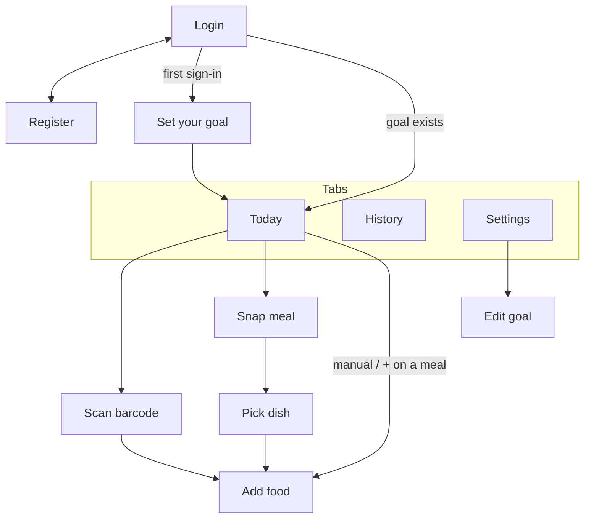

# NutriScan: Project Plan

A MyFitnessPal-style app for losing weight. You set a goal, and the app works out a daily calorie target. You log food by **scanning a barcode** or **taking a photo of your meal**, which an on-device AI model recognises. The app then tracks your calorie deficit day by day.

- **Course:** Mobile Application Development coursework (solo project)
- **Stack:** plain **React Native** (Community CLI, TypeScript) · React Navigation · Supabase · Open Food Facts · TensorFlow Lite. **No Expo** anywhere.
- **Build and test:** the `android/` folder is a normal Android Studio project. You build an APK in Android Studio and install it on the emulator or a phone.
- **Status (6 Oct 2026):** Phases 0 and 1 are done in `NutriScanRN/`: React Native 0.87.1, all screens ported and restyled from the design system, NutriScan Supabase project live, app running on the Android Studio emulator. Phase 2's meal recognition is built, plus a MyFitnessPal-style **food search** (USDA + Open Food Facts + a Mauritian foods table) and a USDA backup for barcodes. Still open: the device checklist, filling the Mauritian foods table, the `source` column and the accuracy table.
- **Design:** [NutriScan design system](https://claude.ai/artifact/6VSeF1Fj3rfbLLBgyECxAM) and [screen mockups](https://claude.ai/artifact/QxhYV8HXPhv1wjXbxDomoV) in Claude Design. `src/lib/theme.ts` holds the same tokens.

---

## 1. Purpose, problem and users

**Problem.** To lose weight, you need to eat fewer calories than you burn (a *calorie deficit*). Most people don't know how many calories they burn or eat, and typing every food in by hand is tedious, so they give up.

**Purpose.** NutriScan makes logging fast:
- It calculates a personal daily target from your body details.
- A barcode scan fills in packaged food automatically.
- A meal photo is recognised by an AI model, so you don't have to type it.
- It shows how much you have left today and how big your deficit was this week.

**Target users.** Adults trying to lose or maintain weight who own an Android phone, including students and young professionals. No nutrition knowledge needed.

### Similar apps we looked at

| App | Stack | What we learned |
|---|---|---|
| [Kalo](https://github.com/Yan739/kalo) | Expo SDK 56, React Native 0.85, SQLite | Closest match: barcode via Open Food Facts + "AI plate recognition". Photos are sent to a **cloud** Food-101 model (101 dishes) and matched to a bundled calorie table. Also uses Mifflin–St Jeor |
| [OpenNutriTracker](https://github.com/simonoppowa/OpenNutriTracker) | Flutter, Supabase | Same breakfast / lunch / dinner / snack split; barcode scanning with a **type-the-barcode fallback**; data encrypted with the Android Keystore |
| [MagicMeal](https://github.com/phishy/magicmeal) | Expo, Supabase, Open Food Facts | The AI photo feature is a placeholder; its docs only suggest cloud APIs (OpenAI, Google Vision, Clarifai) |
| [Waistline](https://github.com/davidhealey/waistline) | Cordova | Open Food Facts + USDA lookups, local food database |
| Cal AI, SnapCalorie, MyFitnessPal | Commercial, cloud AI | In independent tests, photo apps **underestimated meals by 250–345 kcal on average**, mostly by guessing portions wrong |

**What this means for NutriScan**
- None of the open-source React Native apps run the AI **on the phone**. NutriScan's offline food recognition is a real point of difference.
- All of the similar React Native apps use Expo, so there's no plain React Native app to copy the Android setup from. That's why Phase 0 starts with a small proof-of-concept build.
- Commercial apps get portions wrong, which supports our design: the app suggests 3 dishes, and the user always picks the dish and the portion.

**Ideas we skipped:** a local SQLite cache / offline-first diary (Kalo, OpenNutriTracker), because Supabase is the backend the brief rewards; a "recent foods" quick-add, until the core works; a bundled calorie table like Kalo's, which isn't practical for 2,023 dishes.

---

## 2. How it meets the brief

| Brief requirement | How NutriScan meets it |
|---|---|
| Not a simple CRUD app | Calorie maths (BMR, maintenance, deficit), live barcode lookup, on-device AI food recognition, weekly deficit analysis |
| **≥ 2 hardware features** (3.2) | **Camera** (barcode scanning and meal photos), **local notifications** (meal reminders), **fingerprint sensor** (app lock) |
| Runtime permissions (3.3) | Camera and notifications requested with React Native's `PermissionsAndroid` only when needed, after an explanation screen, with a path to Settings if refused ([section 10](#10-security-and-permissions)) |
| Secure, token-based login (3.3) | Supabase Auth: email and password, issues short-lived JWT access tokens plus refresh tokens |
| Validation and sanitisation (3.3) | `zod` schemas on every form, plus database `CHECK` constraints; barcodes are digits only before going into a URL |
| Protect sensitive data (3.3) | Row Level Security (users only see their own rows), Android Keystore for the app lock and the encrypted login session, fingerprint lock, microphone permission stripped from the manifest, HTTPS only, **Delete my account and data** in Settings, **no secret keys in the app** (USDA goes through an Edge Function), **Privacy Policy, Terms and explicit health-data consent** |
| Multiple screens, structured navigation | 10 screens: bottom tabs inside a native stack, with auth-dependent screens |
| State management, real logic | Auth/goal context, per-screen state, derived totals |
| Backend / API (encouraged) | Supabase (Postgres + Auth + Storage + an Edge Function proxy for USDA), Open Food Facts and USDA FoodData Central APIs |
| Bonus: AI integration | Open-source food classifier running **on the phone** |
| Bonus: cloud backend | Supabase |
| Bonus: offline | Food recognition works with no internet. **Offline diary (built 6 Oct):** your goal, the days you've opened and the week are kept on the phone; foods added offline are saved on the phone and sent automatically when you're back online. Food search and barcode lookup still need a connection |
| Bonus: multi-language | **English, French and Kreol Morisien** (Settings → Language), every text checked by `npm run check` |
| Cross-platform | React Native builds for Android and iOS from one codebase; the `ios/` folder is kept. **Built and tested on Android only** |

**Marking weights** (from the brief's marking scheme): UI/UX **30%**, Functionality **30%**, Device integration **20%**, Security **20%**. UI/UX carries as much weight as functionality, so Phase 3 polish matters.

---

## 3. Features

**In scope (MVP)**
1. **Account:** register, sign in, sign out.
2. **Goal setup:** sex, age, height, weight, activity level and weekly target lead to a maintenance figure and a daily calorie target.
3. **Today diary:**
   - a calorie ring showing kcal left or over,
   - "Goal − Food = Left",
   - protein, carbs and fat totals,
   - foods grouped by breakfast, lunch, dinner and snack: **tap a food to edit it** (amount, meal, name, nutrients; the same form as Add food, with **Save changes** and **Remove**), long-press to delete,
   - **past days (built 6 Oct):** ‹ › arrows step back through earlier days ("Yesterday", "Sun 4 Oct"), and tapping a bar on History opens that day. Foods added while a past day is shown are logged to that day, including via Scan and Snap.
   - **Recent foods (built 6 Oct):** Add food lists your last 8 different foods. Tap one to fill the form, or tap ＋ to log it again in one tap with the same amount.
4. **Barcode scan:** camera reads EAN/UPC codes; Open Food Facts (worldwide), then USDA's branded foods (strong on US products) return the name, photo, kcal, macros per 100 g and serving size; you pick a serving or type grams, and it's saved.
   - **Missing products (built 6 Oct):** if no database knows the barcode, you type the details from the pack's label, and **Add to diary** also saves the product to NutriScan's shared `community_foods` table. The next scan of that barcode, by any NutriScan user, finds it, with a notice to check it against the label. These products also show up in Search. (We can't add to USDA, and Open Food Facts' write API needs a username and password, which can't be kept secret inside an APK.)
   - **Scan nutrition label (built 7 Oct):** Add food → **Scan nutrition label** opens the camera. Like the barcode scanner, you just point it: a silent photo about every second is read **on the phone** by Google ML Kit text recognition (`LabelReaderModule.kt`, the app's own small Android module; the photo is deleted straight after). `src/lib/nutritionLabel.ts` finds the Energy, Fat, Carbohydrate and Protein rows (English and French), takes the per-100 g column, or converts US per-serving labels using the serving size. It fills the form only when the four values agree (kcal ≈ 4 × protein + 4 × carbs + 9 × fat, within 25%), which catches misread digits; after 8 seconds **Use what was found** fills in whatever was read. Tested by `npm run check` with EU, US and French label layouts. **Android only** (the iOS version would need the same small module in Swift).
5. **Meal photo (AI):** take a photo, the on-device model suggests the top 3 dishes, you pick one, the app estimates kcal per 100 g, you pick a portion size, and it's saved.
6. **Food search (MyFitnessPal style):** type "banana", "briani" or "nutella" and get one ranked list from our Mauritian foods table, USDA plain foods and Open Food Facts brands. Tapping a result fills kcal, protein, carbs and fat per 100 g and offers its serving sizes ("1 banana = 126 g"). Anything can still be typed in by hand.
7. **History:** a 7-day bar chart against your target, average eaten, total deficit and estimated fat lost.
8. **Settings:** meal reminders on/off, fingerprint lock on/off, edit goal, sign out, **delete my account and data** (built 6 Oct: asks first, then the `delete_my_account()` database function deletes the login, and the goal and diary go with it; the phone's reminders, lock and offline copies are cleared too).
9. **Points, streaks and badges (built 6 Oct):** worked out from the diary itself (`src/lib/progress.ts`, tested by `npm run check`), so there is no extra table.
   - **Points:** +10 for a day with 2+ meals logged, +5 per barcode or photo log (up to 3 a day), +10 for a day within 10% of the target. **Eating below the safe minimum (1,500 / 1,200 kcal) never earns points**: the app rewards consistency, not restriction. Every 100 points is a level.
   - **Streak:** days in a row with food logged, shown on Today.
   - **7 badges:** First bite, On a roll (3-day streak), One week strong (7-day streak), Scanner, Food photographer (5 photo meals), Mauritian explorer (5 Mauritian dishes), Week on target (7 days on target). A "Badge unlocked!" message appears on Today.
   - Crypto rewards were considered and rejected: paying people to eat less is a health risk, crypto tokens are regulated in Mauritius (Virtual Asset and Initial Token Offering Services Act 2021), and real-money keys are a security risk out of scope for this app.

10. **Offline diary (built 6 Oct):** `src/lib/offline.ts`. Every diary day, the week and the goal loaded online are kept on the phone (AsyncStorage, removed on sign-out). With no internet, Today shows that copy under a yellow "You're offline" notice. Foods added offline wait on the phone ("⏳ waiting to sync") and are sent the next time Today loads online. Editing or removing a saved food needs a connection.
    - **Limit:** opening the app offline more than an hour after its last online use takes about 25 seconds, because supabase-js keeps retrying the expired login token before giving up. After that it works offline as normal.
11. **Redesign from MyNetDiary-style ideas (built 8 Oct, mocked up first in Claude Design: [NutriScan screens v2](https://claude.ai/artifact/5Bz7MmcAUVLyt1MzEPDP2m), design system updated to match):**
    - **One scanner, three modes:** Meal | Barcode | Label tabs at the bottom of every camera screen (`components/Scanner.tsx` shared by `Snap`, `Scan` and `Label`), with a flash button, corner brackets and one line of advice. Barcode mode has a **Type in barcode** button. Today now has one primary **Scan food** button plus **Search food**.
    - **Live label panel:** in Label mode a Nutrition Facts-style panel fills in as the camera reads (Serving size, Energy, Fat, of which saturates, Carbohydrate, of which sugars, Fibre, Protein, Salt). Scanning stops when energy, fat, carbs and protein agree; then **Use these values**.
    - **More nutrients:** saturated fat, sugars, fibre and salt are read from Open Food Facts, USDA (through the proxy), labels (salt from sodium × 2.5 on US labels), shared and Mauritian products, and typed into Add food's optional **More nutrients** row. Saved per diary entry (empty = unknown, never 0) and totalled on Today, salt against the 6 g daily maximum.
    - **Today:** ring in the middle with Goal / Food / Left on its left and the four meal totals on its right; macro bars against **targets** (45 / 20 / 35 % of the calorie target, `macroTargets()`), with "% kcal" and "g left"; the ring and figures shrink on phones narrower than 380 dp.
    - **Water:** a card with + / − and 8 drops (250 ml glasses), one `water_intake` row per day.
    - **Dark mode:** follows the phone's setting when the app opens (`theme.ts` picks the light or dark palette; text on green buttons switches to dark for contrast). Reopen the app after changing the phone's theme.

12. **Haptics (built 8 Oct):** `HapticsModule.kt` (the app's second small Android module) plays Android's own patterns: CONFIRM when a barcode or label is read, AI guesses are ready or a food is saved; REJECT when a form is refused or a save fails; CLOCK_TICK for water, scanner tabs and the flash. They follow the phone's touch-feedback setting and need no vibration permission.
13. **Weight log (built 8 Oct):** History opens with a **Weight** card: current weight, change since the first weighing, a line chart (react-native-svg, `chartPoints()` tested), and **Log weight**. One weighing per day (`weight_log` table). Logging a weight also updates the goal's weight and recalculates the calorie target, with a "Daily target updated" message.
14. **Steps from Samsung Health (built 8 Oct):** a **Steps** card on Today reads the day's steps from **Health Connect**, Android's shared health store, where Samsung Health shares its step count (`react-native-health-connect`, read-only `READ_STEPS` permission, `minSdk` raised to 26). It shows steps against 10,000 and an estimate of calories burned walking (0.5 kcal per kg per 1,000 steps), which is **not** added to the calorie target. If Health Connect is missing (Android 13 and older install it from the Play Store) the card offers **Get Health Connect**; if not yet allowed, **Connect steps** opens Health Connect's own permission screen. Steps are never uploaded.
15. **French and Kreol Morisien (built 8 Oct):** `src/lib/i18n.ts` + `translations.ts`, no library. English text is the key, so anything untranslated falls back to English; buttons, field labels, chips, notices and form errors translate centrally. Settings → **Language**; French phones start in French. Dates follow the language. Legal texts stay in English (with a note). `npm run check` fails if any of the ~300 texts lacks a French or Kreol version or the {placeholders} differ. The Kreol (Grafi Larmoni spelling) is a first draft for a native speaker to check.

**Deliberately out of scope** (keeps the app small):
- **Recording exercise in the app.** Steps come from Samsung Health via Health Connect instead.
- **Social features and recipes.**
- **Custom macro goals** (one fixed 45 / 20 / 35 split) and switching dark mode without reopening the app.
- **iOS testing.** The `ios/` folder stays (React Native is cross-platform), but the app is only built and tested on Android.

---

## 4. Screens and navigation



| # | Screen | File | Status |
|---|---|---|---|
| 1 | Login | `src/screens/Login.tsx` | port |
| 2 | Register | `src/screens/Register.tsx` | port |
| 3 | Set your goal (first run) | `src/screens/Setup.tsx` | port |
| 4 | Today (tab) | `src/screens/Today.tsx` | port |
| 5 | History (tab) | `src/screens/History.tsx` | port |
| 6 | Settings (tab) | `src/screens/Settings.tsx` | port |
| 7 | Scan barcode | `src/screens/Scan.tsx` | port (new camera library) |
| 8 | Snap meal + pick dish | `src/screens/Snap.tsx` | built (Phase 2) |
| 9 | Add food (shared by scan, snap and manual) | `src/screens/AddFood.tsx` | port |
| 10 | Edit goal (reuses the setup form) | `src/screens/Goals.tsx` | port |

**Navigation and route protection.** `App.tsx` holds a React Navigation native stack, with the three tabs as its first screen. Which screens exist depends on the auth state, so a signed-out user can't reach Today at all:

```tsx
<Stack.Navigator screenOptions={{ headerShown: false, contentStyle: { backgroundColor: colors.bg } }}>
  {!session ? (
    <>
      <Stack.Screen name="Login" component={Login} />
      <Stack.Screen name="Register" component={Register} />
    </>
  ) : !goals ? (
    <Stack.Screen name="Setup" component={Setup} options={{ ...header, title: 'Set your goal' }} />
  ) : (
    <>
      <Stack.Screen name="Tabs" component={Tabs} />
      <Stack.Screen name="AddFood" component={AddFood} options={{ ...header, title: 'Add food' }} />
      <Stack.Screen name="Goals" component={Goals} options={{ ...header, title: 'Your goal' }} />
      <Stack.Screen name="Scan" component={Scan} options={{ presentation: 'fullScreenModal' }} />
      <Stack.Screen name="Snap" component={Snap} options={{ presentation: 'fullScreenModal' }} />
    </>
  )}
</Stack.Navigator>
```

When the state changes (sign in, goal saved, sign out), React Navigation moves to the first screen of the new set by itself. If the fingerprint lock is on, a lock screen covers the app.

---

## 5. Tech stack

| Layer | Choice | Why |
|---|---|---|
| Framework | React Native 0.87 (via `@react-native-community/cli`), TypeScript, New Architecture | Plain React Native; `android/` is a standard Gradle project |
| IDE and build | **Android Studio** (SDK, its bundled JDK, emulator, Gradle 9.4) | Builds and runs the debug and release APKs |
| Navigation | React Navigation: native stack + bottom tabs | The standard React Native navigator; auth handled by which screens exist |
| Backend | Supabase (Postgres, Auth, Row Level Security) | Free tier, token auth, per-user data security without writing a server |
| Packaged-food data | Open Food Facts API | Free, open data, no API key; ~4M products worldwide |
| Plain-food data | USDA FoodData Central API, reached only through the `usda-search` Supabase Edge Function (built 7 Oct), which holds the free key as a server secret | Generic foods with full nutrients and real serving sizes; branded US foods as a barcode backup. Searched with POST: GET requests with `Survey (FNDDS)` in the URL fail with 400 about half the time |
| Mauritian foods | `mauritian_foods` table in Supabase (`supabase/mauritian_foods.sql`) | Mauritius has no national food composition table, so local dishes are added by hand, each row with its source (INDB, CIQUAL, USDA) |
| Camera | `react-native-vision-camera` v5 (+ `react-native-nitro-modules`, `react-native-nitro-image`) | The standard React Native camera; its photos come out as Nitro Images for the AI model |
| Barcodes | `react-native-vision-camera-barcode-scanner` | VisionCamera's barcode add-on, using Google ML Kit |
| Food recognition | Google AIY `food_V1` TFLite model + `react-native-fast-tflite` v3 | Open source, runs offline on the phone, no API key, about 2,000 dishes |
| Image preprocessing | `react-native-nitro-image` (already a VisionCamera dependency) | Crops, resizes and returns raw pixels natively; no photo file, no JPEG decoding, no extra package |
| Reminders | `react-native-notify-kit` | Local daily notifications with an Android channel; no push server. The maintained fork of Notifee, which was archived in April 2026 |
| Permissions | `PermissionsAndroid` (built into React Native) | One pattern for camera and notifications, including "don't ask again" |
| App lock and secure storage | `react-native-keychain` | Android Keystore + the system fingerprint prompt (BiometricPrompt) in one library |
| Icons | `@react-native-vector-icons/ionicons` | Same Ionicons set the screens already use |
| Session storage | `react-native-keychain` (AES key in the Android Keystore) | Where supabase-js keeps the session: encrypted, never plain text. AsyncStorage only holds which badges you've already seen |
| Validation | `zod` | One schema per form |
| Charts and ring | Plain `View`s + `react-native-svg` | No chart library needed |
| Config | `src/lib/env.ts` (git-ignored) | Holds the Supabase URL and anon key; no dotenv library needed |
| Dev tools | Android Studio, VS Code, Git | |

---

## 6. Data model

Full SQL is in `supabase/schema.sql`. There are 5 tables: `nutrition_goals`, `food_entries` and `water_intake` (Row Level Security: `auth.uid() = user_id`), `mauritian_foods` (read-only reference data, readable by any signed-in user; see `supabase/mauritian_foods.sql`), and `community_foods` (products typed in from the label; see below).

**`weight_log`** (`supabase/weight_log.sql`, 8 Oct): `user_id`, `logged_on`, `weight_kg` (30–300); primary key user + day; RLS own rows.

**Added 8 Oct** (`supabase/nutrients_and_water.sql`): optional `sat_fat_g`, `sugars_g`, `fiber_g`, `salt_g` on `food_entries` (grams eaten) and `sat_fat_100g`, `sugars_100g`, `fiber_100g`, `salt_100g` on `community_foods` and `mauritian_foods`; and **`water_intake`** (`user_id`, `drunk_on`, `glasses` 0–40; primary key user + day, so + and − update one row).

**`community_foods`** (one row per barcode, `supabase/community_foods.sql`)
- `barcode` (PK, digits only), `name`, `kcal_100g`, `protein_100g`, `carbs_100g`, `fat_100g`, `serving_g`, `created_by` (defaults to `auth.uid()`, set to null if that user deletes their account), `created_at`
- **RLS:** any signed-in user can read; you can only add rows as yourself (`created_by = auth.uid()`); nobody can change or delete them from the app. The same `CHECK` ranges as the diary.
- The same file creates `delete_my_account()`: a `security definer` function that deletes `auth.users where id = auth.uid()`, so it can only ever delete the caller. Only signed-in users can run it.

**`nutrition_goals`** (one row per user)
- **Body details:** `user_id` (PK, FK to `auth.users`), `sex`, `age`, `height_cm`, `weight_kg`
- **Goal choices:** `activity`, `weekly_loss_kg`
- **Calculated targets:** `maintenance_kcal`, `daily_kcal`
- **Audit:** `updated_at`

**`food_entries`** (one row per food logged)
- **Who, when, which meal:** `id`, `user_id` (defaults to `auth.uid()`), `eaten_on` (local date), `meal`
- **What and how much:** `name`, `barcode` (nullable), `grams`
- **Nutrition:** `kcal`, `protein_g`, `carbs_g`, `fat_g`
- **Audit:** `created_at`
- **How it was added:** `source` (`'barcode' | 'photo' | 'search' | 'manual'`), added 6 Oct by `supabase/add_food_source.sql`. Drives the diary labels ("scanned", "📷 photo", "search") and the Scanner / Food photographer badges

`CHECK` constraints repeat the app's validation rules (for example grams 1–2000, a fixed set of meal names, barcode digits only), so bad data is rejected even if someone calls the API directly.

---

## 7. Calorie logic

All of it is in `src/lib/calories.ts`, as pure functions tested by `npm run check`. Unchanged by the move away from Expo.

```
BMR         = 10·weight + 6.25·height − 5·age + (male ? 5 : −161)      (Mifflin–St Jeor)
Maintenance = BMR × activity factor (1.2 desk job … 1.725 very active)
Deficit/day = weekly loss (kg) × 7700 kcal ÷ 7
Target      = max(Maintenance − Deficit, 1500 men / 1200 women)       (safety floor)
Food kcal   = kcal per 100 g × grams ÷ 100
Week deficit = Σ (Maintenance − eaten) over days that have food logged
Fat lost    ≈ Week deficit ÷ 7700
```

**Worked example:** a 30-year-old man, 180 cm, 80 kg, desk job, losing 0.5 kg a week.
- BMR = 800 + 1125 − 150 + 5 = 1780
- Maintenance = 1780 × 1.2 = **2136 kcal**
- Deficit = 0.5 × 7700 ÷ 7 = 550, so Target = 2136 − 550 = **1586 kcal/day**

---

## 8. Barcode flow

1. Today → **Scan barcode** opens the camera.
   - If permission isn't granted yet, an explanation screen comes first, then `PermissionsAndroid.request(CAMERA)` shows the system prompt.
   - If the result is `never_ask_again`, the screen offers **Open settings** (`Linking.openSettings()`) or **Enter manually**.
2. VisionCamera's `<CodeScanner>` (from `react-native-vision-camera-barcode-scanner`) with `barcodeFormats` set to EAN-13, EAN-8, UPC-A and UPC-E (copy the exact strings from the package's `BarcodeFormat` type). The first valid code (6–14 digits) is used and later readings are ignored.
   - Below the camera, a **"Type the barcode number"** field does the same lookup (an idea from OpenNutriTracker). It helps when a barcode is damaged, and it's how you test the lookup on the emulator, whose camera can't scan real barcodes.
3. The app calls `GET https://world.openfoodfacts.org/api/v2/product/{code}.json?fields=product_name,brands,image_front_small_url,nutriments`.
4. The Add food screen opens pre-filled, and the meal is pre-selected from the time of day. You enter grams, and a live "This adds N kcal" updates.
5. Save: `zod` validates, then `INSERT` into `food_entries`, then back to Today, which reloads when it comes into focus (`useFocusEffect`).
6. If Open Food Facts doesn't know the code, the app asks USDA's branded foods, trying both the 12-digit (UPC-A) and 13-digit (EAN-13) forms of the code.
7. If neither knows it, NutriScan's own `community_foods` table is checked. If nobody knows it, a yellow notice asks you to type the details from the label; saving also shares the product so the next scan finds it. With no internet, the notice says so and you can still type the details in.

### Food search and Mauritian names (built 6 Oct)
- **Where:** the search box at the top of Add food, with a barcode button beside it (Today → **Search food**, or a meal's **+**).
- **How:** 400 ms after you stop typing, `searchFoods()` (`src/lib/foodSearch.ts`) asks 4 sources at once: the Mauritian foods table, USDA plain foods, Open Food Facts and USDA brands. `rankResults()` (`src/lib/foods.ts`) puts Mauritian foods first, then plain foods, then brands, and drops duplicates.
- **Mauritian names** (`src/lib/mauritian.ts`): typing "briani", "mine frite", "halim", "farata"… searches the databases with the matching English name (biryani, chow mein, haleem, paratha). The photo AI shows local names too (Hyderabadi biryani → **Briani**), and its nutrition estimate now comes from USDA with macros, not just kcal.
- **To fill the Mauritian table:** run `supabase/mauritian_foods.sql` once in the SQL Editor, then fill `supabase/mauritian_foods_template.csv` (name, kcal and macros per 100 g, serving, **source**) and import it in Table Editor. Good sources: INDB (Indian Nutrient Databank, cooked recipes), CIQUAL (French foods), USDA.

---

## 9. Meal recognition with an open-source CV model (Phase 2)

### Model choice
- **Model:** Google AIY Vision **`food_V1`**, a MobileNet V1 image classifier.
  - It covers **2,023 food dishes** plus a background class (2,024 outputs).
  - It's published as an open-source TensorFlow Lite model on TF Hub, now hosted on Kaggle Models.
  - Label list: `https://www.gstatic.com/aihub/tfhub/labelmaps/aiy_food_V1_labelmap.csv` (columns `id,name`).
- **Why this model:**
  - It's already trained, so there's no training work.
  - It's small enough for a phone and runs **offline**.
  - There's no API key to protect.
  - It recognises far more dishes than Food-101 (101 classes).
- **Runtime:** [`react-native-fast-tflite`](https://github.com/mrousavy/react-native-fast-tflite) v3. It's built on Nitro Modules and talks to native code directly, which makes it fast. Inputs and outputs are `ArrayBuffer`s. It autolinks into the Android Studio build.

### Pipeline (as built, 5 Oct)
The plan was live camera frames + `react-native-vision-camera-resizer` + worklets. The build uses a simpler route with the same result: VisionCamera v5's photo comes out as a **Nitro Image**, which already crops, resizes and hands back raw pixels. So the only new package is the TFLite runtime, with no worklets and no Babel changes.

1. **Snap meal** screen (`src/screens/Snap.tsx`): VisionCamera `<Camera device="back" outputs={[photoOutput]}>` with a square guide. The shutter calls `photoOutput.capturePhoto()` and then `photo.toImageAsync()`. Nothing is written to disk or uploaded.
2. **Crop and resize** (`src/lib/foodRecognizer.ts`): `image.cropAsync(...)` takes the centre square, `resizeAsync(w, h)` scales it to the model's input size (read from `model.inputs[0].shape`), and `toRawPixelDataAsync()` returns the pixels.
3. **Convert:** `toRgb()` in `src/lib/classify.ts` turns whatever layout the camera gives (RGBA, BGRA, ARGB…, rows possibly padded) into packed RGB. A `float32` model gets each byte ÷ 255; a `uint8` model gets the bytes as they are.
4. **Run:** `model.run([tensor.buffer])` returns 2,024 scores. `topSuggestions()` skips index 0 (background) and returns the top 3 with their names from `foodLabels.json`.
5. **Pick dish:** 3 cards with confidence bars and percentages, plus **None of these → enter manually** and **Retake photo**. Below 20% confidence, a line says the app isn't sure.
6. **Portion:** chips for Small 150 g, Medium 250 g and Large 400 g. Grams can be changed on the next screen.
7. **Estimate calories:** `searchDishKcal(name)` in `openFoodFacts.ts` takes the **median** `energy-kcal_100g` of the top 5 Open Food Facts search hits. Tested live: Pad Thai 117, 104, 161, 169, 245 → **161 kcal/100 g**; hamburger → 280; a rare dish like "Chaudin" → nothing.
8. **Add food** opens pre-filled (name, kcal/100 g, grams) with a notice that the calories are an estimate. With no estimate (offline, or a rare dish), the notice asks for kcal per 100 g instead.

The pure parts (`toRgb`, `topSuggestions`, `median`) are tested by `npm run check`.

### Setup (done)
- `npm install react-native-fast-tflite` (v3, Nitro-based).
- `metro.config.js` adds `tflite` to `assetExts`.
- `assets/models/food_v1.tflite` (21 MB) from Kaggle: `https://www.kaggle.com/api/v1/models/google/aiy/tfLite/vision-classifier-food-v1/1/download` (a `.tar.gz` holding `1.tflite`; Kaggle rejects HEAD requests, so `curl -I` shows a misleading 404).
- `src/lib/foodLabels.json`: the label CSV as a JSON array of 2,024 names, index = class id.

### Honest limitations (use these in the report)
- **It identifies the dish, not the amount.** The portion is chosen by the user, which is the same compromise MyFitnessPal's own meal scan makes.
- **It recognises one main dish per photo.** Mixed plates get the dominant item.
- **Calories per 100 g are an estimate** taken from similar products. The user can edit every number before saving.
- **Accuracy varies by cuisine and lighting**, which is why the user always confirms one of 3 suggestions instead of the app auto-saving.

---

## 10. Security and permissions

**Permissions** are declared in `android/app/src/main/AndroidManifest.xml`, which replaces Expo's `app.config.ts`:

```xml
<manifest xmlns:android="http://schemas.android.com/apk/res/android"
          xmlns:tools="http://schemas.android.com/tools">
  <uses-permission android:name="android.permission.INTERNET" />
  <uses-permission android:name="android.permission.CAMERA" />
  <uses-permission android:name="android.permission.POST_NOTIFICATIONS" />
  <uses-permission android:name="android.permission.USE_BIOMETRIC" />
  <!-- Least privilege: strip the microphone even if a library asks for it -->
  <uses-permission android:name="android.permission.RECORD_AUDIO" tools:node="remove" />
  ...
```

| Permission | When it's asked | If refused |
|---|---|---|
| Camera | The first time you open Scan or Snap, after an in-app explanation screen (`PermissionsAndroid.request`) | Buttons for **Open settings** and **Enter manually**; nothing crashes |
| Notifications (Android 13+) | When you switch on Meal reminders (`PermissionsAndroid.request(POST_NOTIFICATIONS)`) | The switch goes back to off, with an alert offering **Open settings** |
| Biometrics | `USE_BIOMETRIC` has no dialog. When you switch on Fingerprint lock, a test fingerprint prompt runs first | Lock stays off; if no fingerprint is enrolled, an alert explains why |
| Microphone | **Never.** VisionCamera's setup guide adds `RECORD_AUDIO` for video, but NutriScan never records video, so it's removed from the merged manifest with `tools:node="remove"` | — |

**Other protections**
- **Authentication:** Supabase email and password. Passwords are hashed with bcrypt on the server. The app holds a short-lived JWT access token and a refresh token. Sign-up needs 8+ characters with a letter and a number.
- **Authorisation:** Row Level Security policies on both tables, so a leaked or modified app still can't read other users' rows. The anon key is public by design; RLS is the real security boundary.
- **Validation:** `zod` on every form (types, ranges, email format). Free text is trimmed and has control characters and `<>` stripped. Barcodes must be 6–14 digits. The database repeats these rules with `CHECK` constraints.
- **Sensitive data:**
  - **Fingerprint lock** uses `react-native-keychain`. Turning it on stores a Keystore item that can only be read after a fingerprint check (`ACCESS_CONTROL.BIOMETRY_CURRENT_SET`), and unlocking reads that item, which shows the system fingerprint prompt. If fingerprints are re-enrolled, the item becomes unreadable and the user has to sign in again.
  - The lock applies on cold start and after 30 seconds in the background. The grace period stops permission dialogs from triggering it.
  - **Login session encrypted:** supabase-js saves its tokens through a small adapter in `src/lib/supabase.ts` that stores them with `react-native-keychain` (AES-GCM, key kept in the Android Keystore). Sessions saved as plain text by older versions are moved across once and the plain copy deleted.
  - All traffic is HTTPS; release builds block plain HTTP by default (Android's cleartext policy).
  - `android:allowBackup="false"` (the template's default) keeps the session out of cloud backups.
  - Meal photos and nutrition-label photos are processed on the phone and **never uploaded**, which is privacy by design. Label photos are deleted as soon as they've been read.
  - **Delete my account and data** (Settings) removes the account and its diary from Supabase and clears everything the app kept on the phone.
  - **Offline copies** of the diary are plain AsyncStorage, protected by Android's app sandbox and `allowBackup="false"`, and removed on sign-out. Products shared to `community_foods` contain no personal data; `created_by` is only a user id.
- **Least privilege:** only the permissions listed above, each requested only when needed.
- **No secrets in the app (built 7 Oct):** the APK holds only the Supabase URL and anon/publishable key, which are public by design (RLS is the boundary). The USDA key moved to the `usda-search` Edge Function (`supabase/functions/usda-search/index.ts`) as a Supabase secret. The function:
  - only answers signed-in users (it asks Supabase Auth whose token it is),
  - accepts only a food search (1–100 characters, the 4 known data types, at most 25 results),
  - strips each answer down to the 6 nutrients the app reads, so answers are much smaller on mobile data.
  - The local copy of the key is in `supabase/functions/.env` (git-ignored); it was also in older APKs, so request a new one from api.data.gov when convenient.

**Privacy and consent (built 7 Oct)**
- **Why:** NutriScan stores health data (weight, height, age, diet). Both the Mauritius Data Protection Act 2017 and the GDPR treat this as a special category, so the legal basis is **explicit consent**, recorded and separate from accepting the terms.
- **The text:** the **Privacy Policy** and **Terms of Use** live in `src/lib/legal.ts` and are shown in-app (`screens/Legal.tsx`), so they're readable offline. `npm run legal` writes the same text to `docs/legal/*.txt` for the public copies in a public Supabase Storage bucket `legal`. Plain text is used because Supabase Storage serves HTML as plain text for security.
- **Sign-up:** Register has two separate ticks: agree to the Terms and Privacy Policy, and consent to health data being stored. Both are required (zod). The consent is saved on the account itself (auth user metadata: `consent.version`, `consent.at`).
- **Existing accounts and policy changes:** if an account's consent version isn't the current `POLICY_VERSION`, a **Consent** screen appears before the app opens, offering **Agree**, **Sign out**, or **I don't agree: delete my account**.
- **Settings** links both documents and shows the date you agreed. Withdrawing consent = **Delete my account and data**.
- **Contents:** what's stored and where (Supabase), what stays on the phone (photos, encrypted session), which outside services receive what (Open Food Facts, USDA via our proxy, Google ML Kit's anonymous diagnostics), retention, your rights and the Data Protection Office of Mauritius, security measures, children, and changes.

---

## 11. Porting from Expo

Most of the existing code is plain React Native already. This is what changes:

| Was (Expo) | Now (plain React Native) | Files |
|---|---|---|
| `expo-router` (`Stack`, `Tabs`, `Stack.Protected`, `useRouter`, `useLocalSearchParams`) | React Navigation: `navigation.navigate('AddFood', { meal })`, `route.params`, conditional screens ([section 4](#4-screens-and-navigation)). Expo Router is built on React Navigation, so screen options carry over | `App.tsx`, every screen |
| `expo-camera` | `react-native-vision-camera` v5 + `react-native-vision-camera-barcode-scanner` (`<CodeScanner>`) | `Scan.tsx`, `Snap.tsx` |
| `useCameraPermissions`, notification permission | `PermissionsAndroid` | `Scan.tsx`, `Snap.tsx`, `reminders.ts` |
| `expo-notifications` | `react-native-notify-kit` (Notifee's maintained fork, same API): a channel + 3 trigger notifications repeating daily | `reminders.ts` |
| `expo-local-authentication` + `expo-secure-store` | `react-native-keychain` | `AuthContext.tsx`, `Settings.tsx` |
| `@expo/vector-icons` | `@react-native-vector-icons/ionicons` | 6 files (import line only) |
| `expo-status-bar`, `expo-linking` | React Native's own `StatusBar`, `Linking` | `App.tsx`, `Scan.tsx` |
| `expo-image-manipulator` + `jpeg-js` (old Phase 2 plan) | Nitro Image (`cropAsync`, `resizeAsync`, `toRawPixelDataAsync`) | `foodRecognizer.ts` |
| `app.config.ts` (name, package, orientation, permissions) | `AndroidManifest.xml`, `strings.xml`, `app/build.gradle` | `android/` |
| `.env` + `EXPO_PUBLIC_*` | `src/lib/env.ts` (git-ignored) + `src/lib/env.example.ts` (committed) | `supabase.ts` |
| `@/` import alias (provided by Expo's Babel) | Relative imports | all |
| `expo-constants`, `expo-font` | Dropped, not needed | — |

**Unchanged:** `calories.ts`, `validation.ts`, `openFoodFacts.ts`, `theme.ts`, `Field`, `Chips`, `ProgressRing`, `supabase/schema.sql`, `scripts/check-calories.mjs`, and the supabase-js, AsyncStorage, `react-native-svg` and `zod` code.

### Project structure after the port

```
NutriScan/
├── android/                     native Android project: open this folder in Android Studio
│   ├── app/src/main/AndroidManifest.xml   permissions, portrait lock
│   ├── app/src/main/res/        app name, icon, splash
│   └── gradle.properties
├── index.js                     registers App
├── App.tsx                      providers, stack + tabs, lock screen
├── metro.config.js              (Phase 2) bundle .tflite files
├── assets/models/               (Phase 2) food_v1.tflite
├── supabase/schema.sql          tables, constraints, RLS policies
├── scripts/check-calories.mjs   self-check for the calorie maths (npm run check)
└── src/
    ├── screens/                 Login, Register, Setup, Goals, Today, History, Settings, Scan, Snap, AddFood
    ├── components/              Button, Field, Chips, ProgressRing, GoalsForm
    ├── contexts/AuthContext.tsx session, goals, app lock
    └── lib/
        ├── calories.ts          pure maths and date helpers
        ├── validation.ts        zod schemas
        ├── openFoodFacts.ts     barcode lookup (+ dish search in Phase 2)
        ├── foodRecognizer.ts    (Phase 2) photo → TFLite → top 3
        ├── classify.ts          (Phase 2) pure helpers: pixels → RGB, top 3, median
        ├── foodLabels.json      (Phase 2) 2,024 dish names
        ├── reminders.ts         local notifications (notify-kit)
        ├── supabase.ts          client
        ├── env.ts               Supabase URL + anon key (git-ignored)
        └── theme.ts             colours and shared styles
```

`android/` is now real source code and is committed to Git. Only `android/app/build/`, `android/.gradle/` and `android/local.properties` are ignored (the template's `.gitignore` already does this).

---

## 12. Build plan

### Phase 0: Setup (1 day)
- [x] Create a **new** Supabase project for NutriScan (done 6 Oct).
  - Don't reuse the HRFlow one: its sign-up trigger would add HRFlow rows for every NutriScan user.
  - **Right now `src/lib/env.ts` still points at the HRFlow project**, which has no NutriScan tables (checked 5 Oct: `nutrition_goals` and `food_entries` return 404). Sign-up and saving fail until this is done. Paste the new project's URL and anon key into `env.ts`, then rebuild the APK.
- [x] In the Supabase SQL Editor, run `supabase/schema.sql`.
- [x] Turn email confirmation off for development and testing: Authentication → Sign In / Providers → Email.
- [x] Set up the toolchain ([section 17](#17-android-studio-setup-and-building-the-apk)): Node 22.11+, Android Studio (its bundled JDK works), an emulator. NDK 27.1 and CMake installed themselves on the first build.
- [x] Create the React Native project next to the old one:
  ```bash
  npx @react-native-community/cli@latest init NutriScan --directory NutriScanRN --package-name com.nutriscan.app
  ```
- [x] Open `NutriScanRN/android` in Android Studio, let Gradle sync, press ▶ Run, and confirm the blank template app starts on the emulator. (Done from a terminal: the template's release APK built in 12 minutes.) This proves the toolchain works before any libraries are added.
- [x] **Proof of concept first (½ day).** (The camera and barcode half was proven in the real build; the TFLite half moves to the start of Phase 2.) This is the riskiest part, so prove it before porting anything:
  - In the new project, install VisionCamera v5 + the barcode scanner + fast-tflite + the resizer and worklets (package lists below and in [section 9](#9-meal-recognition-with-an-open-source-cv-model-phase-2)).
  - Show a camera that logs scanned barcodes and the model's top 3 to Logcat.
  - Build the **release APK** in Android Studio and run it on the emulator.
  - If it won't build on React Native 0.87, recreate the project with `--version 0.85` ([section 16](#16-risks-and-fallbacks)).
- [x] Delete `__tests__/` from the template (`npm run check` is the unit test). **Keep `ios/`**: the brief asks for cross-platform, and React Native gives that for free.
- [x] Copy `src/`, `supabase/`, `scripts/` and `PLAN.md` over from the Expo folder. Add the `typecheck` and `check` scripts to `package.json`.
- [x] Install the packages (zod pinned to `^3`, AsyncStorage to `^2`, as the existing code expects):
  ```bash
  npm install @react-navigation/native @react-navigation/native-stack @react-navigation/bottom-tabs react-native-screens react-native-safe-area-context
  npm install @supabase/supabase-js @react-native-async-storage/async-storage react-native-url-polyfill zod react-native-svg
  npm install react-native-vision-camera react-native-nitro-modules react-native-nitro-image react-native-vision-camera-barcode-scanner
  npm install react-native-notify-kit react-native-keychain @react-native-vector-icons/ionicons
  ```
  Then follow each library's **Android** install section (VisionCamera's getting-started page, the Ionicons font step).
- [x] Edit `AndroidManifest.xml` ([section 10](#10-security-and-permissions)) and add `android:screenOrientation="portrait"` to `MainActivity`.
- [x] Copy `src/lib/env.example.ts` to `src/lib/env.ts` and paste in the project URL and anon key. Do this **before** building a release APK: the values are bundled into it.
- [ ] Once the ported app runs, delete the old Expo folder and rename `NutriScanRN` to `NutriScan`.

### Phase 1: Port to plain React Native, then verify (2–3 days)
- [x] `App.tsx`: providers, `StatusBar`, stack + tabs with conditional screens, lock screen ([section 4](#4-screens-and-navigation))
- [x] Move the screens to `src/screens/`, swap `router.push/replace/back` for `navigation.navigate/replace/goBack` and `useLocalSearchParams` for `route.params`
- [x] Swap `@expo/vector-icons` imports and `@/` imports
- [x] `Scan.tsx` on VisionCamera's `<CodeScanner>` + `PermissionsAndroid`, plus the "Type the barcode number" field
- [x] `reminders.ts` on notify-kit; `AuthContext.tsx` and `Settings.tsx` on Keychain
- [x] `npm run typecheck && npm run lint && npm run check` pass; release APK builds
- [ ] Install the release APK on the emulator and on your phone, then verify:
  - [ ] Register → set goal → Today shows the correct target (compare with the worked example in [section 7](#7-calorie-logic))
  - [ ] Barcode: scan a real product → details filled in → save → appears under the right meal
  - [ ] Unknown barcode → notice shown → manual entry works
  - [ ] Manual add; long-press to delete
  - [ ] History chart and deficit numbers match a hand calculation
  - [ ] Reminders on/off; a reminder fires (temporarily set one 1 minute ahead to test)
  - [ ] Fingerprint lock on → close the app → reopen → locked → unlock works
  - [ ] Every permission refused → the app explains and offers a way out; no crash
- [ ] Fix whatever these find

### Phase 2: Meal recognition (2–3 days)
- [x] Install the packages and set up Metro, the model file and the labels JSON ([section 9](#9-meal-recognition-with-an-open-source-cv-model-phase-2)); Gradle sync and rebuild
- [x] Write `foodRecognizer.ts` (photo → Nitro Image → TFLite)
- [ ] Point the phone (or the emulator's webcam) at 5 food photos on your PC screen and note the top 3 for each
- [x] Build the `Snap.tsx` screen: camera → Analysing… → top-3 cards → portion → Add food
- [x] Add `searchDishKcal(name)` (median of the Open Food Facts search) to `openFoodFacts.ts`
- [x] Add the `source` column, then show 📷 or barcode badges in the diary (run `supabase/add_food_source.sql`)
- [ ] Build an accuracy table: photograph 20 real meals and record whether the right dish was top-1 and whether it was in the top 3

### Phase 3: Polish (1–2 days)
- [ ] Empty states (no food today, no history yet), loading states, offline messages (offline notice on Today done 6 Oct)
- [x] Run `supabase/community_foods.sql` once in the SQL Editor (needed for missing products and Delete account)
- [ ] Deploy the `usda-search` Edge Function and add the `USDA_API_KEY` secret (Dashboard → Edge Functions)
- [ ] Create the public Storage bucket `legal` and upload `docs/legal/privacy-policy.txt` and `docs/legal/terms.txt`
- [ ] App icon: Android Studio → right-click `app/src/main/res` → New → **Image Asset**
- [ ] Splash: Android 12+ splash theme in `res/values/styles.xml` (`windowSplashScreenBackground`, `windowSplashScreenAnimatedIcon`); no library
- [ ] Accessibility pass: labels on icon buttons, touch targets ≥ 44 px, readable contrast
- [ ] Final `npm run typecheck && npm run lint && npm run check`

### Phase 4: Deliverables (2–3 days)
- [ ] Technical report, 2,500–5,000 words, as a PDF ([section 14](#14-report-outline-brief-5))
- [ ] Architecture and navigation diagrams. The [section 4](#4-screens-and-navigation) diagram can be reused.
- [ ] Screenshots of every screen (emulator toolbar → camera icon)
- [ ] Demo video, 10–15 minutes ([section 15](#15-demo-video-outline-1015-min))
- [ ] Final release APK signed with your own keystore: Android Studio → Build → **Generate Signed App Bundle / APK** → APK → create a new keystore (keep the file and passwords out of Git)

---

## 13. Testing plan (brief 5.6)

| Type | What | How |
|---|---|---|
| Unit | Calorie maths, dates, weekly deficit | `npm run check` (assertions in `scripts/check-calories.mjs`) |
| Static | Types and code quality | `npm run typecheck`, `npm run lint` |
| Functional | Every item in the Phase 1 and 2 checklists | Manual test cases table in the report: steps → expected → actual → pass/fail |
| Validation | Bad input is rejected | Empty name, 0 g, 5000 g, letters in number fields, mismatched passwords, invalid email |
| Security | RLS works | Sign in as user B: user A's food must not appear. Try inserting with another `user_id` in the Supabase API: rejected |
| Permissions | Refusing every permission | Deny camera, deny notifications, no fingerprint enrolled → each shows guidance, no crash. Reset with `adb shell pm reset-permissions` or by reinstalling |
| Manifest | Least privilege | Android Studio → Build → **Analyze APK** → `AndroidManifest.xml` shows no `RECORD_AUDIO` |
| Device | Real phone and emulator | The same release APK on at least 1 physical Android phone + an Android Studio emulator (different screen sizes) |
| AI accuracy | Recognition quality | Top-1 / top-3 accuracy table from 20 meal photos |

---

## 14. Report outline (brief 5)

| Section | Where the content comes from |
|---|---|
| 5.1 Introduction | [Section 1](#1-purpose-problem-and-users), including the similar-apps table as related work |
| 5.2 System design | Architecture diagram (app ↔ Supabase ↔ Open Food Facts; on-device model), the [section 4](#4-screens-and-navigation) navigation diagram, screenshots as wireframes |
| 5.3 Features | [Sections 3](#3-features), [8](#8-barcode-flow) and [9](#9-meal-recognition-with-an-open-source-cv-model-phase-2); hardware = camera, notifications, fingerprint |
| 5.4 Security | [Section 10](#10-security-and-permissions) |
| 5.5 Tools and technologies | [Section 5](#5-tech-stack): React Native CLI, Android Studio (Gradle, emulator, Logcat, APK Analyzer), VS Code, Git; why plain React Native over Expo |
| 5.6 Testing | [Section 13](#13-testing-plan-brief-56) + filled-in test tables + accuracy table |
| 5.7 Conclusion | What works; limitations ([section 9](#9-meal-recognition-with-an-open-source-cv-model-phase-2), no step tracking), compared with commercial apps that underestimate meals by 250–345 kcal; future work (portion estimation, Health Connect steps, dark mode, iOS testing) |

---

## 15. Demo video outline (10–15 min)

1. **Introduction (1 min):** the problem and who the app is for.
2. **Account (1 min):** register, with validation errors shown.
3. **Goal setup (1 min):** the target updates live as you change details.
4. **Barcode (2 min):** a real product; then an unknown barcode, entered manually.
5. **Meal photo (3 min):** recognise 2–3 real dishes, pick a suggestion, choose a portion, save. Show the recognition still working in airplane mode (the kcal estimate needs a connection; offline you type it in).
6. **Today and History (2 min):** the ring, macros, delete, weekly deficit.
7. **Settings (2 min):** a reminder firing, the fingerprint lock, refusing camera permission.
8. **Code and security tour (2 min):** the project open in Android Studio, `AndroidManifest.xml` permissions, RLS policies, zod schemas, permission handling, the calorie maths check.
9. **Wrap-up (30 s):** limitations and future work.

---

## 16. Risks and fallbacks

| Risk | Fallback |
|---|---|
| VisionCamera v5, worklets or fast-tflite won't build on React Native 0.87 | Found in the Phase 0 proof of concept. Recreate the project with `--version 0.85` (notify-kit's development target and Kalo's version) |
| Recognition is slow or wrong on some phones | Try the `'android-gpu'` or `'nnapi'` delegate in `loadTensorflowModel`; rotate the image by `photo.orientation` before cropping (currently ignored, see the `ponytail:` note in `foodRecognizer.ts`) |
| `react-native-fast-tflite` fails to build | Try `onnxruntime-react-native` with an ONNX export of the model. Last resort: a Supabase Edge Function running a Hugging Face Food-101 model, like Kalo does (photo leaves the phone; say so in the report) |
| `react-native-notify-kit` fails to build or schedule | A small Kotlin native module in Android Studio using `AlarmManager` + `NotificationCompat` (also good material for the report) |
| Gradle sync or build fails (JDK, NDK, CMake) | Install JDK 17 and set it as the Gradle JDK in Android Studio; install the exact NDK version named in `android/build.gradle` via SDK Manager; Build → Clean Project, or `cd android && gradlew clean` |
| Windows path-length limit: a native build loops on "Re-running CMake" and fails (happened 5 Oct with the barcode scanner) | Already handled: `android/build.gradle` gives each native library a short build folder under `.cxx/`. The app's own C++ objects reach 248 of the 250 allowed characters, so **don't move the project into a longer folder path**. The full fix is Windows long paths: in an admin PowerShell, `Set-ItemProperty HKLM:SYSTEMCurrentControlSetControlFileSystem LongPathsEnabled 1`, then restart |
| Library bugs found while testing on the emulator (6 Oct) | All fixed: (1) VisionCamera's `<CodeScanner>` throws "No Camera device available!" if it draws before the camera list loads, closing the app. Scan now builds the scanner from `useCameraDevice` + `useBarcodeScannerOutput` and shows "Starting camera…". (2) `react-native-fast-tflite` 3.0.1 can't load a `require()`d model in **release** APKs (it treats the res/raw name as a URL). Fixed in `patches/react-native-fast-tflite+3.0.1.patch`, re-applied by `npm install` (patch-package). (3) Snap switched the camera off while the photo was still being taken ("Camera is closed"). Both camera screens also have an error boundary, so a camera failure shows a message instead of closing the app. The whole app is wrapped in one too (`src/components/ErrorBoundary.tsx`): any other drawing error shows "Something went wrong" with **Try again** |
| Emulator camera can't scan or recognise real food | Emulator → Extended controls → Camera → back camera = virtual scene or webcam; do real-food tests on a phone |
| Model accuracy poor on local dishes | The top-3 picker plus manual edit always gives the user the final say; record real accuracy honestly in the report |
| Open Food Facts slow or down | Manual entry; the app shows a clear notice |
| Supabase free project pauses after a week idle | Restore it from the dashboard (same keys and data). Open the app a few days before the demo |

---

## 17. Android Studio setup and building the APK

**One-off setup (Windows)**
- **Node.js 22.11 or newer** (React Native 0.87's minimum). `npm run check` passes `--experimental-strip-types`, so the `.ts` import also works on Node 22.11–22.17.
- **JDK:** nothing to install. Android Studio's bundled JDK 25 builds React Native 0.87 (Gradle 9.4.1) fine, and Android Studio uses it by default. From a terminal, set `JAVA_HOME` to `C:Program FilesAndroidAndroid Studiojbr` first. (React Native's docs still say JDK 17; switch to it only if a build fails with a Java version error.)
- `ANDROID_HOME` = `%LOCALAPPDATA%\Android\Sdk`; add `%ANDROID_HOME%\platform-tools` to `PATH` (for `adb`).
- NDK 27.1, CMake and SDK platform 37 download automatically on the first build (about 12 minutes). `android/gradle.properties` builds only `arm64-v8a,x86_64` (phones and the emulator) to halve native build time.
- Device Manager: any API 36 emulator with Google Play (your existing one is fine).

**Two kinds of APK**

| | Debug APK | Release APK |
|---|---|---|
| Use it for | Coding: edits show instantly | Testing, demos, handing in |
| JavaScript | Loaded live from Metro on your PC | Bundled inside the APK |
| Needs your PC running | Yes: `npm start` | No, it runs on its own |
| Signed with | Debug key | Debug key (template default); your own keystore for the final hand-in |

**Daily coding (debug)**
1. Terminal: `npm start` (Metro).
2. Android Studio: open the `android/` folder, pick the emulator, press **▶ Run**.
3. On a USB phone, run `adb reverse tcp:8081 tcp:8081` once so it can reach Metro.

**Test APK (release)**
1. Android Studio → Build → Select Build Variant → `app` = **release**.
2. Build → **Build App Bundle(s) / APK(s) → Build APK(s)**. The JS bundle is built into the APK automatically.
3. Output: `android/app/build/outputs/apk/release/app-release.apk`.
4. Install: drag the APK onto the emulator, or `adb install -r android/app/build/outputs/apk/release/app-release.apk`. On a phone, copy the APK over and allow "Install unknown apps".

Rebuild the APK after changing native packages, `AndroidManifest.xml`, `env.ts` (release) or anything in `android/`.

---

## 18. Commands

```bash
npm install                     # once, and after adding packages
npm start                       # Metro, for the debug APK
npm run android                 # build + install the debug APK from a terminal (same as ▶ Run)
cd android && gradlew assembleRelease   # release APK from a terminal (same as Build APK(s))
npm run check                   # calorie maths self-check
npm run typecheck               # TypeScript
npm run lint                    # ESLint
```

---

### References
- React Native environment setup (Android, Windows): https://reactnative.dev/docs/set-up-your-environment
- React Native: signed release APK: https://reactnative.dev/docs/signed-apk-android
- React Navigation, authentication flows: https://reactnavigation.org/docs/auth-flow
- VisionCamera v5 docs (camera, barcode scanner, resizer, frame output): https://visioncamera.margelo.com/
- react-native-fast-tflite: https://github.com/mrousavy/react-native-fast-tflite
- react-native-notify-kit (maintained Notifee fork; Notifee archived 7 April 2026): https://github.com/marcocrupi/react-native-notify-kit
- react-native-keychain: https://github.com/oblador/react-native-keychain
- Similar apps: Kalo https://github.com/Yan739/kalo · OpenNutriTracker https://github.com/simonoppowa/OpenNutriTracker · MagicMeal https://github.com/phishy/magicmeal · Waistline https://github.com/davidhealey/waistline
- Photo calorie app accuracy (Cal AI, SnapCalorie, MyFitnessPal): https://programminginsider.com/best-photo-calorie-tracking-apps-2026/
- Open Food Facts API: https://openfoodfacts.github.io/openfoodfacts-server/api/
- AIY food classifier label map: https://www.gstatic.com/aihub/tfhub/labelmaps/aiy_food_V1_labelmap.csv
- Mifflin MD, St Jeor ST et al. (1990). *A new predictive equation for resting energy expenditure in healthy individuals.* Am J Clin Nutr 51(2):241–247.
